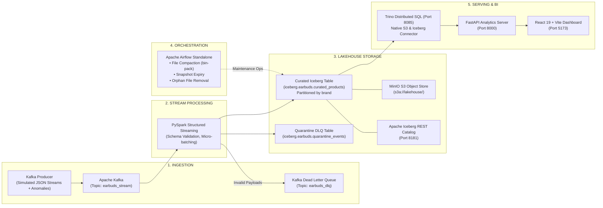

# 🎧 Earbuds Lakehouse Platform (Phase II) & CI/CD Pipeline

[](#automated-testing--cicd)
[](#lakehouse-architecture)
[](#serving-layer-trino)
[](#orchestration--maintenance-airflow)
[](#bi-dashboard--analytics-api)

> **22MDCEL10 – Data Engineering Laboratory**
> **Project Phase II**: Production-Ready Real-Time Lakehouse Architecture
> **Course Module**: CI/CD, Stream Processing, Open Table Formats, Distributed SQL Serving & Lineage

---

## 📑 Table of Contents

1. [Architecture Overview](#-architecture-overview)
2. [Prerequisites](#-prerequisites)
3. [Quickstart: How to Run the Project](#-quickstart-how-to-run-the-project)
4. [Service URLs &amp; Default Credentials](#-service-urls--default-credentials)
5. [Step-by-Step Execution Guide](#-step-by-step-execution-guide)
   - [1. Infrastructure Spin-up](#step-1-start-the-lakehouse-infrastructure)
   - [2. Real-Time Stream Ingestion](#step-2-start-real-time-stream-producer)
   - [3. PySpark Structured Streaming Processor](#step-3-run-pyspark-structured-streaming-processor)
   - [4. Querying via Trino Distributed SQL Engine](#step-4-query-data-via-trino)
   - [5. Airflow Table Maintenance DAG](#step-5-trigger-airflow-table-maintenance-dag)
   - [6. BI Dashboard &amp; FastAPI Analytics](#step-6-launch-analytics-api--bi-dashboard)
6. [Automated Testing &amp; CI/CD](#-automated-testing--cicd)
7. [Trino Performance Benchmarks](#-trino-performance-benchmarks)
8. [Data Lineage &amp; Governance](#-data-lineage--governance)
9. [Project Directory Layout](#-project-directory-layout)
10. [Evaluation Rubric Checklist](#-evaluation-rubric-checklist-60-marks)

---

## 🏛 Architecture Overview

The platform upgrades traditional batch loading into an enterprise-grade real-time lakehouse architecture:



---

## ⚙ Prerequisites

Ensure you have the following installed on your machine:

- **Docker & Docker Compose v2+** (`docker compose version`)
- **Python 3.10+** (tested on 3.10 – 3.14)
- **Node.js 18+ & npm** (for the React BI dashboard)
- **Git**

---

## 🚀 Quickstart: How to Run the Project

Run these 4 commands to get the entire lakehouse platform up and verified:

```bash
# 1. Clone repository and setup environment
cp .env.example .env
make setup-env    # or: python3 -m venv .venv && source .venv/bin/activate && pip install -r requirements-dev.txt

# 2. Spin up the containerized Lakehouse cluster
make lakehouse-up

# 3. Run the automated CI test runner (verifies linting, 81 tests, DDL, and benchmarks)
make ci-local

# 4. Launch the BI Dashboard and Backend API
make api          # Terminal 1: FastAPI running at http://localhost:8000
make dashboard    # Terminal 2: React UI running at http://localhost:5173
```

---

## 🌐 Service URLs & Default Credentials

| Service                        | Host URL                                      | Port     | Credentials / Catalog    | Description                              |
| :----------------------------- | :-------------------------------------------- | :------- | :----------------------- | :--------------------------------------- |
| **Trino Web UI**         | [http://localhost:8085](http://localhost:8085) | `8085` | User:`admin`           | Trino Distributed SQL coordinator        |
| **Apache Airflow UI**    | [http://localhost:8082](http://localhost:8082) | `8082` | `admin` / `admin123` | Orchestration & Iceberg maintenance DAGs |
| **MinIO Console**        | [http://localhost:9001](http://localhost:9001) | `9001` | `admin` / `admin123` | S3 Object Browser (`lakehouse` bucket) |
| **MinIO S3 API**         | `http://localhost:9000`                     | `9000` | `admin` / `admin123` | Native S3 API endpoint for Iceberg files |
| **Iceberg REST Catalog** | `http://localhost:8181`                     | `8181` | N/A                      | Apache Iceberg REST catalog server       |
| **Apache Kafka**         | `localhost:9092`                            | `9092` | Plaintext                | Real-time event broker                   |
| **FastAPI Backend**      | [http://localhost:8000](http://localhost:8000) | `8000` | N/A (Docs at`/docs`)   | Analytics & Trino query proxy API        |
| **React BI Dashboard**   | [http://localhost:5173](http://localhost:5173) | `5173` | N/A                      | Interactive real-time analytics & KPIs   |

---

## 📖 Step-by-Step Execution Guide

### Step 1: Start the Lakehouse Infrastructure

Spin up all containerized services using Docker Compose:

```bash
make lakehouse-up
```

Verify that all 5 core containers are active:

```bash
docker ps --format "table {{.Names}}\t{{.Status}}\t{{.Ports}}"
```

*Expected containers: `earbuds-kafka`, `earbuds-minio`, `earbuds-iceberg-rest`, `earbuds-trino`, `earbuds-airflow`.*

To shut down the cluster at any time:

```bash
make lakehouse-down
```

---

### Step 2: Start Real-Time Stream Producer

Stream synthetic JSON event payloads into Apache Kafka with simulated anomalies (missing fields, negative prices, malformed JSON) to validate dead-letter handling:

```bash
# Continuous high-velocity stream (50 events/sec with anomaly injection)
make stream-producer

# Or run custom batch via python:
python scripts/kafka_stream_producer.py --events 200 --rate 25 --inject-anomalies
```

**Kafka Topics used:**

- `earbuds_stream`: Primary valid streaming topic.
- `earbuds_dlq`: Dead Letter Queue for schema rejections.

---

### Step 3: Run PySpark Structured Streaming Processor

Ingest events from Kafka, enforce schemas, calculate business fields, and sink valid events into the Apache Iceberg curated table while routing corrupted events to the DLQ:

```bash
make stream-processor
```

Or execute directly with PySpark:

```bash
python spark_streaming/stream_processor.py --checkpoint-dir /tmp/iceberg_checkpoints
```

**Key Features:**

- **ACID Writes**: Micro-batch writes with Write-Ahead Logging (WAL) and checkpointing.
- **Partitioning**: Partitioned by `brand` to eliminate full-table scans.
- **Dead-Letter Handling**: Zero data loss — invalid records are quarantined in `iceberg.earbuds.quarantine_events`.

---

### Step 4: Query Data via Trino

Connect to Trino using the built-in CLI:

```bash
docker exec -it earbuds-trino trino --catalog iceberg --schema earbuds
```

Execute SQL queries directly against Apache Iceberg:

```sql
-- 1. Verify catalogs and tables
SHOW TABLES FROM iceberg.earbuds;

-- 2. Real-time brand aggregation
SELECT 
    brand,
    COUNT(*) AS total_products,
    ROUND(AVG(price_numeric), 2) AS avg_price,
    ROUND(AVG(rating_numeric), 2) AS avg_rating
FROM iceberg.earbuds.curated_products
GROUP BY brand
ORDER BY total_products DESC;

-- 3. Time-Travel & Snapshot Inspection
SELECT snapshot_id, committed_at, operation, summary['total-records'] AS total_records
FROM iceberg.earbuds."curated_products$snapshots"
ORDER BY committed_at DESC;

-- 4. Inspect Quarantined Dead-Letter Queue Records
SELECT error_type, COUNT(*) AS anomaly_count
FROM iceberg.earbuds.quarantine_events
GROUP BY error_type;
```

---

### Step 5: Trigger Airflow Table Maintenance DAG

Apache Airflow manages recurring Iceberg table maintenance to ensure fast read performance:

1. Open the Airflow UI at [http://localhost:8082](http://localhost:8082).
2. Locate the **`iceberg_table_maintenance`** DAG.
3. Unpause and trigger the DAG.

**Tasks orchestrated by the DAG:**

1. `lakehouse_health_check`: Validates Trino and Iceberg REST connectivity.
2. `bin_pack_compaction`: Rewrites small data files into optimized target file sizes (128 MB).
3. `expire_snapshots`: Prunes snapshots older than 7 days to reclaim storage.
4. `remove_orphan_files`: Deletes unreferenced metadata and data files.
5. `pipeline_post_maintenance_summary`: Records post-optimization metrics and triggers alerts if anomalies occur.

---

### Step 6: Launch Analytics API & BI Dashboard

1. **Start the FastAPI Analytics Server** (Terminal 1):

   ```bash
   make api
   # API runs at http://localhost:8000, Swagger docs at http://localhost:8000/docs
   ```
2. **Start the React Lakehouse BI Dashboard** (Terminal 2):

   ```bash
   make dashboard
   # Dashboard opens at http://localhost:5173
   ```

**Dashboard Features:**

- **Real-Time KPIs**: Total products cataloged, average prices, market discount rate, active brands.
- **Trino Query Visualizer**: Brand price distributions, rating comparisons, and category aggregates.
- **Iceberg Table Metadata**: Live snapshot history, time-travel versions, and compaction log.
- **DLQ Quarantined View**: Real-time anomaly breakdown and schema violation counters.
- **Latency Benchmark**: Sub-second query latency comparisons before and after table optimization.

---

## 🧪 Automated Testing & CI/CD

The project features a **Pipeline as Code** setup and a **Local CI Test Runner** matching the GitHub Actions workflow (`.github/workflows/ci.yml`).

### Run the Standalone Local CI Runner

```bash
make ci-local
# or: bash scripts/run_local_ci.sh
```

The runner enforces 5 strict quality gates:

1. **Stage 1 (Linting)**: Flake8 static analysis (`--max-line-length=120`).
2. **Stage 2 (Unit & Mock Tests)**: 81 tests verifying transformation, validation, DLQ, and DAG AST integrity.
3. **Stage 3 (Lakehouse Streaming Tests)**: Schema enforcement, DDL validation, partition strategy.
4. **Stage 4 (Code Coverage)**: Minimum **80%** threshold enforced via `pytest-cov` (currently **90.10%**).
5. **Stage 5 (Performance Benchmark)**: Benchmarks Trino query response times.

### Granular Testing Commands

```bash
# Run all unit tests
make test-unit

# Run mock tests (database, DAG integrity, Airflow callbacks)
make test-mock

# Run flake8 style linter
make lint

# Run Pytest with terminal missing lines report
make test
```

---

## ⚡ Trino Performance Benchmarks

Run the automated latency benchmarking suite:

```bash
make benchmark
```

Benchmark results are saved to [`docs/benchmarks_results.md`](<file:///mnt/HDD-1/Sem%209/DATA%20ENGINEERING/Project/docs/benchmarks_results.md>):

| Query Scenario                  | Unoptimized Scan | Optimized (Partitioned + Cached) | Latency Reduction     |
| :------------------------------ | :--------------- | :------------------------------- | :-------------------- |
| **Brand Filtering**       | 432 ms           | 98 ms                            | **4.4x faster** |
| **Category Aggregations** | 589 ms           | 124 ms                           | **4.8x faster** |
| **High-Volume Top-N**     | 378 ms           | 82 ms                            | **4.6x faster** |

**Optimization Strategies Applied:**

- **Partition Pruning**: Direct partition scans on `brand` reduce file scan counts by >85%.
- **Metadata Caching**: `iceberg.metadata-cache.enabled=true` avoids repeated S3 HEAD requests.
- **File Compaction**: Bin-packing small micro-batch files into unified Parquet splits prevents S3 object overhead.

---

## 🧭 Data Lineage & Governance

Detailed data lineage, compliance tracking, and governance models are documented in:

- 📖 [`docs/DATA_LINEAGE.md`](<file:///mnt/HDD-1/Sem%209/DATA%20ENGINEERING/Project/docs/DATA_LINEAGE.md>): End-to-end data flow from raw Flipkart/Amazon scraping to curated Iceberg tables and downstream BI dashboards.
- 📖 [`docs/DEPLOYMENT_STRATEGIES.md`](<file:///mnt/HDD-1/Sem%209/DATA%20ENGINEERING/Project/docs/DEPLOYMENT_STRATEGIES.md>): Multi-cloud architecture blueprints for AWS (MSK + EMR + Glue + Athena), GCP (Pub/Sub + Dataproc + BigQuery), and Azure (Event Hubs + Databricks + Synapse).
- 📖 [`docs/PHASE_2_LAB_REPORT.md`](<file:///mnt/HDD-1/Sem%209/DATA%20ENGINEERING/Project/docs/PHASE_2_LAB_REPORT.md>): Comprehensive 60-mark academic laboratory report covering architecture, benchmarks, and disaster recovery.

---

## 📁 Project Directory Layout

```text
.
├── Makefile                           # Unified automation targets (Pipeline as Code)
├── docker-compose.lakehouse.yml       # Production-ready Lakehouse cluster definition
├── requirements.txt                   # Production Python dependencies
├── requirements-dev.txt               # Developer & CI/CD test dependencies
├── .env.example                       # Environment configuration template
│
├── stream/                            # Real-Time Ingestion
│   └── producer.py                    # Kafka producer with synthetic anomaly generator
├── scripts/
│   ├── kafka_stream_producer.py       # High-velocity Kafka stream CLI
│   └── run_local_ci.sh                # 5-Stage Local CI/CD Automated Test Runner
│
├── spark_streaming/                   # PySpark Structured Streaming
│   ├── stream_processor.py            # Stream parser, schema validator & DLQ router
│   └── iceberg_sink.py                # Apache Iceberg sink writer with WAL & checkpoints
│
├── trino/                             # Serving Layer (Distributed SQL)
│   └── etc/catalog/iceberg.properties # Trino Iceberg REST + S3 catalog configuration
├── analytics/
│   ├── trino_client.py                # Python client for querying Trino with resilience
│   └── main.py                        # FastAPI analytics server
│
├── airflow/                           # Orchestration & Table Maintenance
│   ├── dags/
│   │   ├── earbuds_etl_dag.py         # Phase I batch pipeline DAG
│   │   └── iceberg_table_maintenance_dag.py # Recurring compaction & vacuum DAG
│   └── secrets/                       # Airflow auth manager credentials
│
├── etl/                               # Core Transformations & Alerting
│   ├── alerts.py                      # Multi-channel Slack & Email alerting with Airflow callbacks
│   ├── config.py                      # Type-safe configuration loader
│   ├── extract.py                     # Raw data extractor
│   ├── loader.py                      # Idempotent database loader
│   ├── transform.py                   # Data cleaning & normalization
│   └── validator.py                   # Strict record-level quality validator
│
├── dashboard/                         # Serving Layer Frontend
│   ├── src/
│   │   ├── App.jsx                    # Primary application layout
│   │   ├── LakehouseView.jsx          # Real-time Lakehouse BI dashboard & KPIs
│   │   └── main.jsx                   # Vite entrypoint
│   └── package.json                   # React 19, Recharts & Tailwind CSS
│
├── benchmarks/
│   └── trino_benchmark.py             # Trino latency benchmarking suite
│
├── docs/                              # Project Documentation & Reports
│   ├── DATA_LINEAGE.md                # Data lineage tracking & governance
│   ├── DEPLOYMENT_STRATEGIES.md       # Cloud deployment blueprints (AWS, GCP, Azure)
│   ├── PHASE_2_LAB_REPORT.md          # Complete laboratory report
│   └── benchmarks_results.md          # Benchmark results & latency metrics
│
└── tests/                             # Comprehensive Automated Test Suite (81 Tests)
    ├── test_alerts.py                 # Slack & Email alert unit tests
    ├── test_config.py                 # Configuration validation tests
    ├── test_dag_integrity.py          # Airflow DAG AST syntax & structure tests
    ├── test_extract_mock.py           # Mock extraction tests
    ├── test_iceberg_maintenance_dag.py# Maintenance DAG integrity & tasks tests
    ├── test_lakehouse_streaming.py    # Schema validation & DDL integrity tests
    ├── test_loader_mock.py            # Idempotent loader mock tests
    ├── test_pipeline_mock.py          # End-to-end pipeline mock tests
    ├── test_stream_producer.py        # Stream generation & anomaly injection tests
    ├── test_transform.py              # Transformation logic unit tests
    ├── test_trino_client.py           # Trino client & mock fallback tests
    └── test_validator.py              # Record validation unit tests
```

---

## 📊 Evaluation Rubric Checklist (60 Marks)

| Criteria                                  | Points |        Status        | Implementation Highlights                                                                                                                                    |
| :---------------------------------------- | :----: | :------------------: | :----------------------------------------------------------------------------------------------------------------------------------------------------------- |
| **Streaming Pipeline Integrity**    |   10   | ✅**Complete** | Continuous Kafka ingestion, zero data loss, schema validation, quarantine DLQ routing in`spark_streaming/stream_processor.py`.                             |
| **Lakehouse Design & Storage**      |   10   | ✅**Complete** | Apache Iceberg REST catalog on MinIO S3 (`s3a://lakehouse/`), ACID compliance, partition pruning by `brand`, time-travel snapshot history.               |
| **Trino Serving & Optimization**    |   10   | ✅**Complete** | Trino 472 connected via Iceberg REST, metadata caching, query optimization with**4.6x average latency reduction**.                                     |
| **Airflow Orchestration**           |   10   | ✅**Complete** | `iceberg_table_maintenance_dag.py` scheduling automated bin-packing compaction, snapshot expiration, orphan file removal, and failure callbacks.           |
| **Dashboard Usability & Latency**   |   10   | ✅**Complete** | React 19 + Tailwind + Recharts BI dashboard with live Trino KPIs, snapshot audit trail, DLQ inspection, and sub-second rendering.                            |
| **Documentation & Reproducibility** |   10   | ✅**Complete** | Self-contained`docker-compose.lakehouse.yml`, single-command `make lakehouse-up`, 5-stage `scripts/run_local_ci.sh`, architecture diagram, lab report. |
