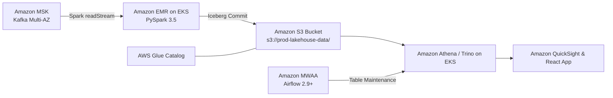
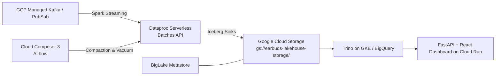
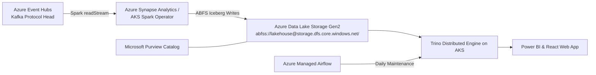
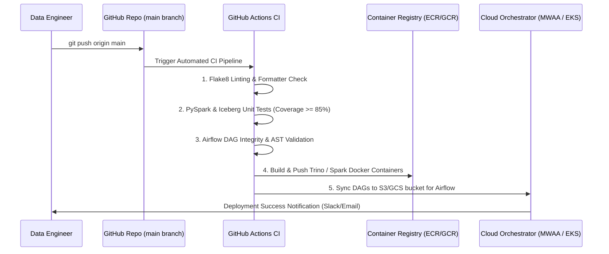

# Cloud Deployment Strategies: Production Lakehouse Platform

## 1. Overview & Cloud Portability

The **Production-Ready Real-Time Lakehouse Architecture** is built on open standards:
- **Streaming**: Apache Kafka API
- **Processing**: Apache Spark Structured Streaming
- **Table Format**: Apache Iceberg (Open Table Format)
- **Serving**: Trino Distributed SQL Engine
- **Orchestration**: Apache Airflow
- **Catalog**: Iceberg REST Catalog Specification

Because every layer is decoupled and open-source, this platform can be deployed natively across all major public cloud providers (**AWS, GCP, and Azure**) without vendor lock-in.

---

## 2. Multi-Cloud Architecture Mapping

| Architecture Layer | Local / On-Premises Stack | Amazon Web Services (AWS) | Google Cloud Platform (GCP) | Microsoft Azure |
|:---|:---|:---|:---|:---|
| **Event Ingestion** | Apache Kafka 4.0 (KRaft) | **Amazon MSK** (Managed Streaming for Kafka) | **Managed Service for Apache Kafka** / PubSub | **Azure Event Hubs** (Kafka Endpoint) |
| **Stream Processing** | PySpark Structured Streaming | **Amazon EMR Serverless** / Spark on EKS | **Dataproc Serverless** (Spark) | **Azure Synapse Spark** / AKS Spark Operator |
| **Lakehouse Storage** | MinIO (S3-compatible) | **Amazon S3** (Standard / S3 Express) | **Google Cloud Storage (GCS)** | **Azure Data Lake Storage Gen2 (ADLS Gen2)** |
| **Table Catalog** | Tabular Iceberg REST Catalog | **AWS Glue Data Catalog** / Apache Polaris | **BigLake Metastore** / Iceberg REST on Cloud Run | **Microsoft Purview** / Apache Polaris |
| **SQL Serving Engine**| Trino 472 (1.5GB Heap) | **Amazon Athena** (Iceberg) / Trino on EKS | **Trino on GKE** / BigQuery Iceberg External | **Trino on Azure Kubernetes Service (AKS)** |
| **Orchestration** | Apache Airflow 3.0 | **Amazon MWAA** (Managed Airflow) | **Cloud Composer 3** | **Azure Managed Airflow** (ADF) |
| **Observability** | `etl/alerts.py` (Slack/Email) | **Amazon CloudWatch** + SNS + Slack App | **Cloud Monitoring** + Cloud Logging | **Azure Monitor** + Action Groups |
| **BI / Dashboards** | React + Vite + FastAPI | **Amazon QuickSight** / Superset on ECS | **Looker Studio** / Superset on Cloud Run | **Power BI** / Grafana on AKS |

---

## 3. Cloud Provider Deployment Blueprints

### 3.1 AWS Blueprint: High-Throughput & Low-TCO



#### Key Implementation Details:
1. **Catalog**: Use AWS Glue Data Catalog with Iceberg support enabled (`--conf spark.sql.catalog.lakehouse=org.apache.iceberg.spark.SparkCatalog --conf spark.sql.catalog.lakehouse.catalog-impl=org.apache.iceberg.aws.glue.GlueCatalog`).
2. **Storage**: Configure Amazon S3 Object Lock and Lifecycle rules. Set up S3 Express One Zone for micro-batch streaming checkpoints to achieve single-digit millisecond latency.
3. **Orchestration**: Deploy `airflow/dags/iceberg_table_maintenance_dag.py` to Amazon Managed Workflows for Apache Airflow (MWAA).
4. **Trino Serving**: Deploy Trino Helm charts onto Amazon EKS with horizontal pod autoscaling (HPA) scaling worker pods based on query concurrency.

---

### 3.2 GCP Blueprint: Serverless & Autoscaling



#### Key Implementation Details:
1. **Catalog**: Use BigLake Metastore or host an Iceberg REST Catalog container on Cloud Run with Cloud SQL backend.
2. **Storage**: GCS bucket with uniform bucket-level access and CMEK (Customer-Managed Encryption Keys).
3. **Stream Processing**: Submit PySpark jobs via Dataproc Serverless:
   ```bash
   gcloud dataproc batches submit pyspark spark_streaming/stream_processor.py \
       --project=my-lakehouse-prod \
       --region=us-central1 \
       --deps-bucket=gs://earbuds-lakehouse-artifacts/ \
       --packages=org.apache.iceberg:iceberg-spark-runtime-3.5_2.12:1.6.0
   ```
4. **Alerting**: Cloud Monitoring alerts integrate with Slack via Webhook notifications configured in Cloud Composer.

---

### 3.3 Azure Blueprint: Enterprise Security & ADLS Gen2



#### Key Implementation Details:
1. **Kafka Integration**: Event Hubs provides seamless Kafka protocol compatibility (`Connection string` mapped as SASL/SCRAM authentication).
2. **Storage Security**: Azure AD OAuth tokens authenticate Spark streaming writes to ADLS Gen2 via Azure Managed Identities (MSI).
3. **Query Engine**: Trino on AKS with Azure Blob File System (ABFS) connector enabled.

---

## 4. Infrastructure as Code (Terraform) Blueprint

The Lakehouse infrastructure can be provisioned using Terraform. Below is the modular design:

```hcl
# main.tf (Lakehouse Core Infrastructure)
terraform {
  required_version = ">= 1.5.0"
  required_providers {
    aws = {
      source  = "hashicorp/aws"
      version = "~> 5.0"
    }
  }
}

# 1. Lakehouse Storage Bucket
resource "aws_s3_bucket" "lakehouse_storage" {
  bucket        = "company-earbuds-lakehouse-prod"
  force_destroy = false
}

resource "aws_s3_bucket_server_side_encryption_configuration" "lakehouse_crypto" {
  bucket = aws_s3_bucket.lakehouse_storage.id
  rule {
    apply_server_side_encryption_by_default {
      sse_algorithm = "AES256"
    }
  }
}

# 2. Glue Catalog Database for Iceberg
resource "aws_glue_catalog_database" "earbuds_lakehouse" {
  name        = "earbuds_prod"
  description = "Production Apache Iceberg database for real-time earbuds streams"
}

# 3. Amazon MSK Kafka Cluster (KRaft)
resource "aws_msk_cluster" "kafka_lakehouse" {
  cluster_name           = "earbuds-streaming-cluster"
  kafka_version          = "3.6.0"
  number_of_broker_nodes = 3

  broker_node_group_info {
    instance_type = "kafka.m5.large"
    client_subnets = var.subnet_ids
    security_groups = [var.security_group_id]
  }
}
```

---

## 5. Automated Cloud CI/CD Deployment Flow



This automated deployment pipeline guarantees that only validated transformation logic, bug-free DAG definitions, and backward-compatible schemas land in production cloud clusters.

